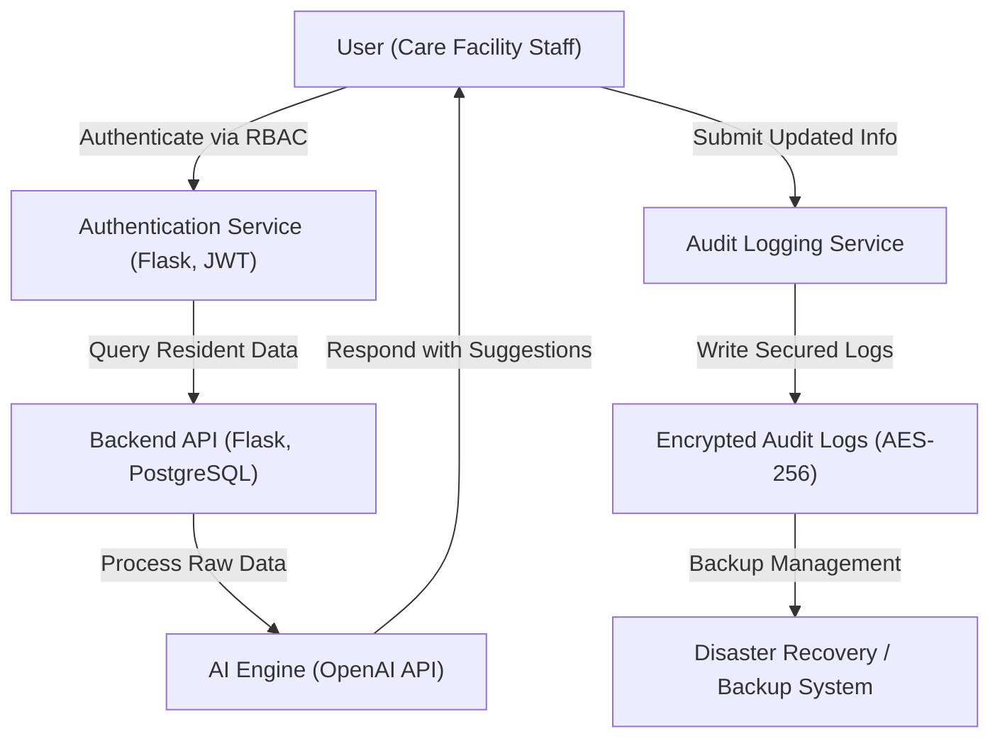

# Elderly Management System  
  
  
  
  
  
  

### Executive Summary  
The **Elderly Management System** is a robust platform for securely managing resident data and streamlining operations in elderly care facilities. By leveraging advanced encryption, AI-powered assistance, and audited access controls, the system prioritizes security and compliance in high-risk domains.

---

### Key Features
- **Resident Data Management**: Centralized management of sensitive resident data with end-to-end AES-256 authenticated encryption.  
- **Access Control**: Role-Based Access Control (RBAC) with exhaustive permission management at object, tenant, and action levels.  
- **AI-Assisted Operations**: OpenAI-powered features for intelligent suggestions with explicit consent workflows, human reviews, and versioned prompt tracking.  
- **Audit Logging**: Comprehensive event logging to ensure traceability of all system interactions.  
- **Privacy by Design**: Data redaction, secure backups, and containerized service isolation.  
- **Disaster Recovery**: Backup and recovery procedures with documented key rotation, revocation, and restoration processes.  
- **Observability & Security Scans**: Full production observability with sensitive-field filtering, container scans, and dependency vulnerability checks.  

---

### Architecture & Workflow

#### System Workflow Overview  


---

### Tech Stack & Tools
1. **Backend**:  
   - [Flask](https://flask.palletsprojects.com) (core application logic and API development).  
   - [PostgreSQL](https://www.postgresql.org/) (secure relational database with compliance-grade support).  
   - [AES-256 Encryption](https://en.wikipedia.org/wiki/Advanced_Encryption_Standard) for data protection.  

2. **Frontend**:  
   - [Streamlit](https://streamlit.io/) (intuitive interface for staff to interact with the platform).  

3. **AI Features**:  
   - [OpenAI API](https://platform.openai.com/docs) (AI-driven suggestions and reasoning capabilities for decision support).  

4. **Infrastructure**:  
   - [Docker Compose](https://docs.docker.com/compose/) (microservices orchestration).  
   - [Nginx](https://nginx.org/) (secure reverse proxy for API traffic).  

5. **Security & Observability**:  
   - Key Management System (KMS) for secure key handling with rotation and revocation capabilities.  
   - RBAC for granular access control.  
   - Audit logging with sensitive-field redaction.  
   - Dependency and container vulnerability scanning tools.  

---

### Quickstart / Installation

#### Prerequisites  
Ensure the following are installed on your system:  
- Docker & Docker Compose  
- Python 3.10+  

#### Setup Instructions  
1. Clone the repository:  
   ```bash
   git clone https://github.com/EF361/elderly-management-system.git  
   cd elderly-management-system  
   ```

2. Create a `.env` file in the root directory and configure environment variables for DB credentials, encryption keys, OpenAI API keys, etc. A template is provided as `.env.template`.

3. Build and start the services using Docker Compose:  
   ```bash
   docker-compose up --build  
   ```

4. Access the system:  
   - API: `http://localhost:5000`  
   - Streamlit Web Interface: `http://localhost:8501`  

5. Run tests (including role-based access and data migration tests):  
   ```bash
   python -m unittest discover tests/  
   ```

6. Monitor logs and metrics (ensure sensitive-field filtering is configured):  
   - Logs:  
     ```bash
     docker-compose logs -f
     ```  
   - Metrics: Visit integrated observability tools at `http://localhost:xxxx` (depending on Nginx port forwarding).  

---

### Compliance & Data Governance  
#### 1. Standards & Jurisdictions  
This system is designed to align with:  
- **HIPAA** (Health Insurance Portability and Accountability Act) for resident data handling in the USA.  
- **GDPR** (General Data Protection Regulation) for data privacy in Europe.  
- **SOC 2** principles (Security, Availability, Privacy), though not yet certified.  

#### 2. Security Practices  
- Encrypted at-rest and in-transit data.  
- RBAC tests verified across roles and multi-tenant boundaries.  
- Managed KMS ensures key lifecycle management (rotation, backup, restoration).  

#### 3. Data Retention  
- Resident data retained per governing policies with automated expiration rules.  
- AI prompts and outputs are versioned and redacted for sensitive fields.  

---

### Future Improvements  
- **Certification**: Map implemented controls to specific clauses within HIPAA, GDPR, and SOC 2 for pre-certification assessments.  
- **Enhanced Observability**: Implement field-level tracing to automate incident responses in production.  
- **AI Evolution**: Introduce an explainability mechanism for AI-generated recommendations.  

For questions or contributions, contact **Alicia Goh (EF361)** via [GitHub Issues](https://github.com/EF361/elderly-management-system/issues).