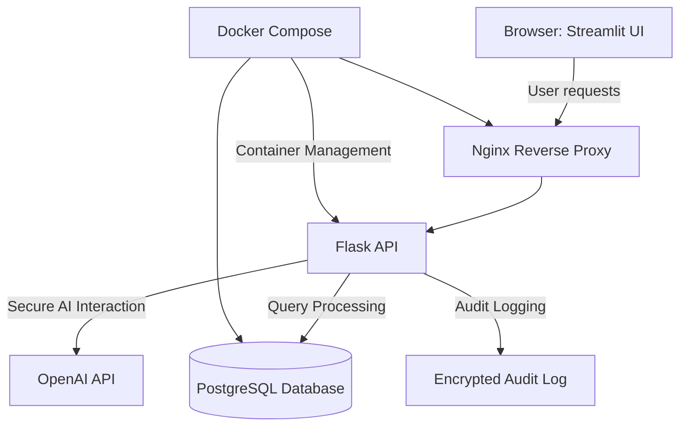

# Elderly Management System


## Executive Summary

The **Elderly Management System** is a security-conscious platform developed to enhance care coordination for elderly residents through robust role-based access control (RBAC), encrypted sensitive data handling, and non-clinical AI-assisted recommendations. Designed for care facilities, the platform emphasizes compliance, security best practices, and audit transparency.

## Key Features

- **Role-Based Access Control (RBAC):** Enforces fine-grained object-level and action-level authorization, guided by backend rules in Flask. UI visibility is not relied upon for security.
- **Secure Data Management:** Uses AES-256 authenticated encryption with key rotation to safeguard sensitive resident data.
- **Compliant AI Assistance:** Employs OpenAI API for non-clinical care recommendations, ensuring personal data is redacted and provenance is recorded. All consequential actions require human confirmation.
- **Comprehensive Threat Mitigation:** Extensive testing for horizontal privilege escalation, CSRF, injection vulnerabilities, insecure direct object references, and more.
- **Dockerized Microservices:** Manages backend and frontend services with **Docker Compose**, enabling consistent deployments with pinned dependency versions and hardened container images.
- **Encrypted Backups:** Database backups are encrypted and comply with defined retention schedules for disaster recovery scenarios.
- **Auditing & Logs Protection:** Implements audit logging to track critical events while ensuring that sensitive data remains excluded from logs.
- **Production-Grade Security:** Includes session isolation, CSRF tokens, and secure secret management procedures documented explicitly for production.
- **Real-Time Alerts:** Supports proactive notification systems for timely updates to caregivers and staff.

## Architecture & Workflow

The architecture comprises modular services for seamless integration, driven by strict security and compliance standards.



1. **Streamlit UI:** Frontend for interacting with the system (e.g., caregiver dashboards, resident profiles).
2. **Nginx:** Provides reverse proxy functionality and enforces HTTPS/TLS.
3. **Flask API:** Handles application logic, RBAC enforcement, and secure integration with OpenAI for recommendations.
4. **PostgreSQL:** Stores resident data, audit logs, and system configurations with strict encryption.
5. **Docker Compose:** Orchestrates all services with pinned images for stability and consistency.

## Tech Stack & Tools Breakdown

- **Backend:** Flask (Python 3.10) for robust API handling and business logic
- **Frontend:** Streamlit for rapid prototyping and caregiver-facing interfaces
- **Database:** PostgreSQL with encryption-at-rest and backups
- **AI:** OpenAI API for generating actionable insights (non-clinical use only)
- **Orchestration:** Docker Compose and Nginx for seamless deployment and scaling
- **Security:** AES-256 encryption, CSRF tokens, session isolation, authenticated encryption, and threat-mitigating tests
- **Automation & CI:** Dependency scanning, container hardening, and security compliance built into pipelines

## Quickstart / Installation

Clone the repository and follow these steps to get the platform running:

```bash
# 1. Clone the repository
git clone https://github.com/EF361/elderly-management-system.git
cd elderly-management-system

# 2. Install Python dependencies
python3.10 -m venv venv
source venv/bin/activate
pip install -r requirements.txt

# 3. Set up environment variables
cp .env.example .env
# Configure environment variables (follow documentation guidance)

# 4. Start services using Docker Compose
docker-compose up --build

# 5. Access the application
# Visit Streamlit at http://localhost:8501
# Backend API available at http://localhost:8000
```

## Compliance Checklist

To ensure legal compliance and data security standards, this platform adheres to:

- **Data Classifications:** Resident data is classified by sensitivity with corresponding encryption and access rules.
- **Threat Model:** Annually audited to cover privilege escalation, injection attacks, and other common vectors.
- **Retention Policy:** Enforces data retention periods for backups and logs, with policies for secure deletion.
- **Consent Model:** Captures user consent transparently at onboarding and before AI API use.
- **Breach Procedures:** Follows jurisdiction-specific notification timelines for security breaches, with forensic audit logs in place.
  
Contributions and feedback are welcomed, particularly in security testing and compliance improvement. Let's build a safer platform for elder care!